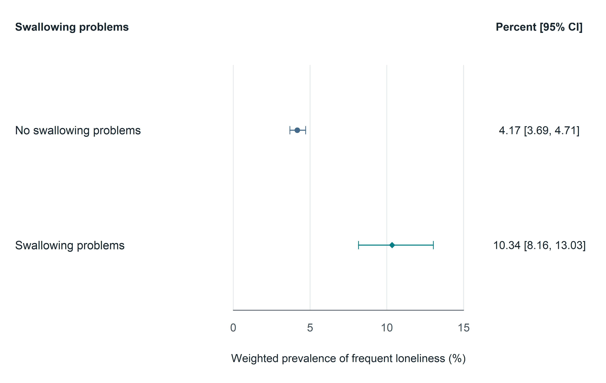
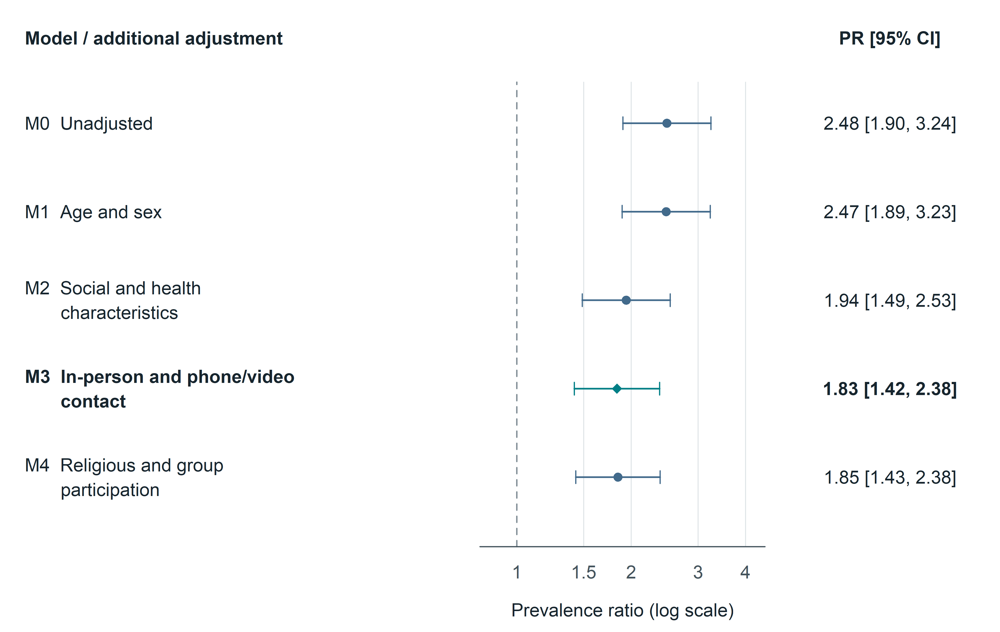
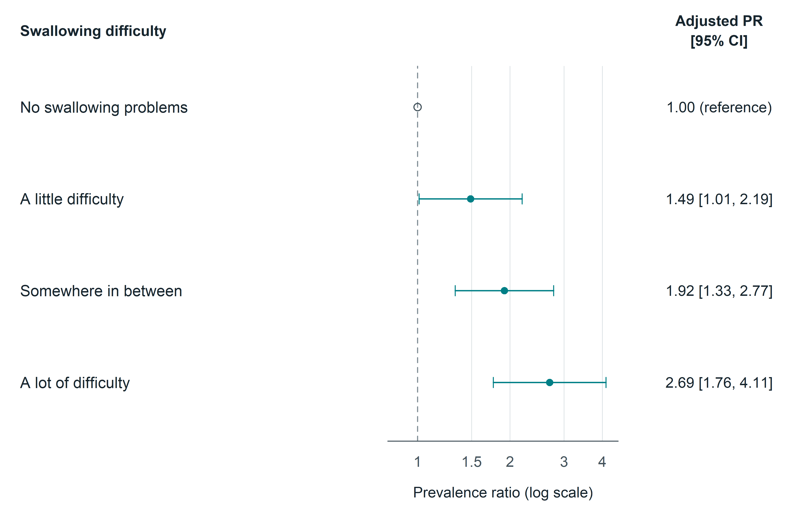
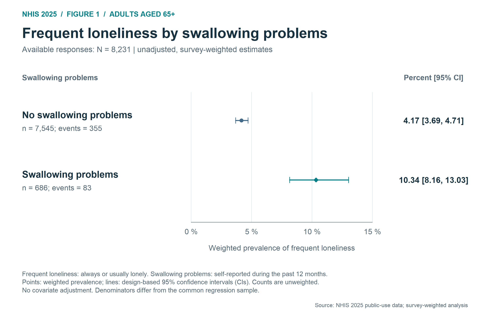
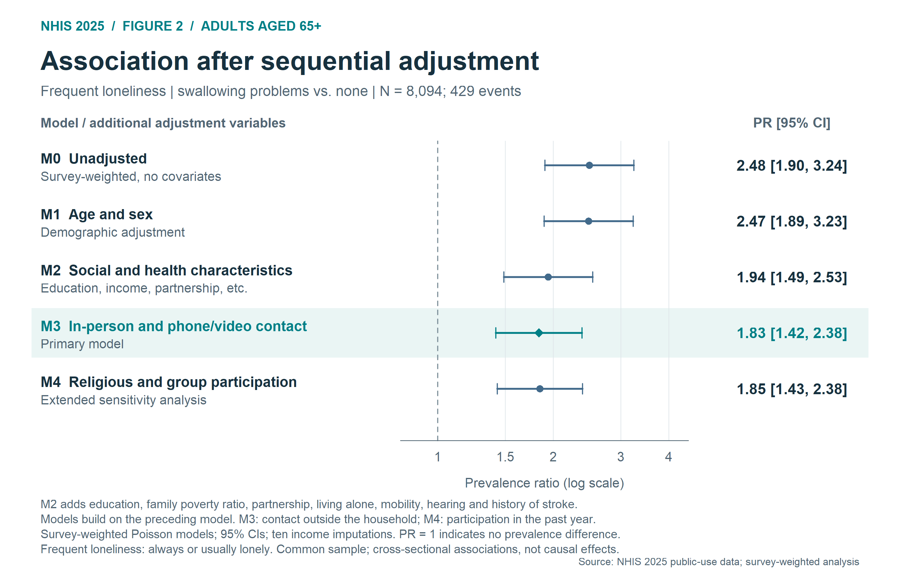
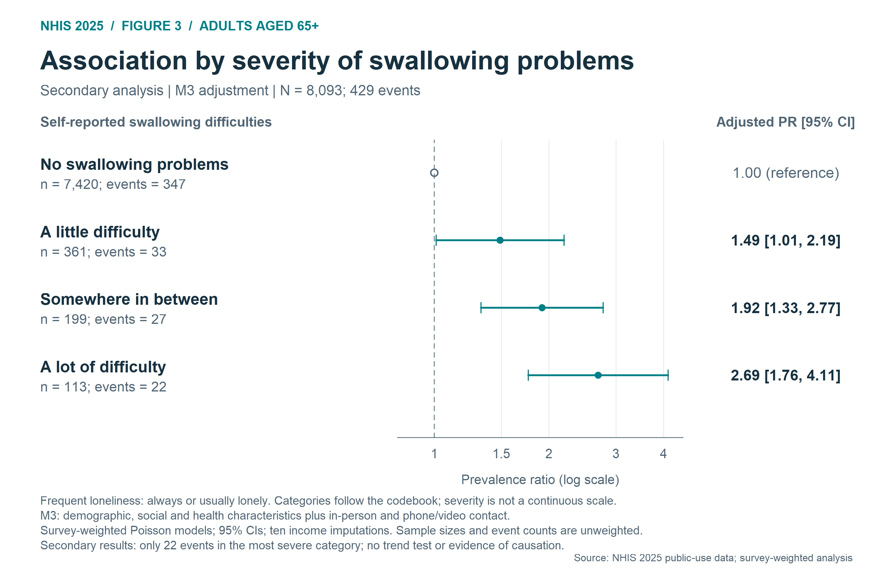
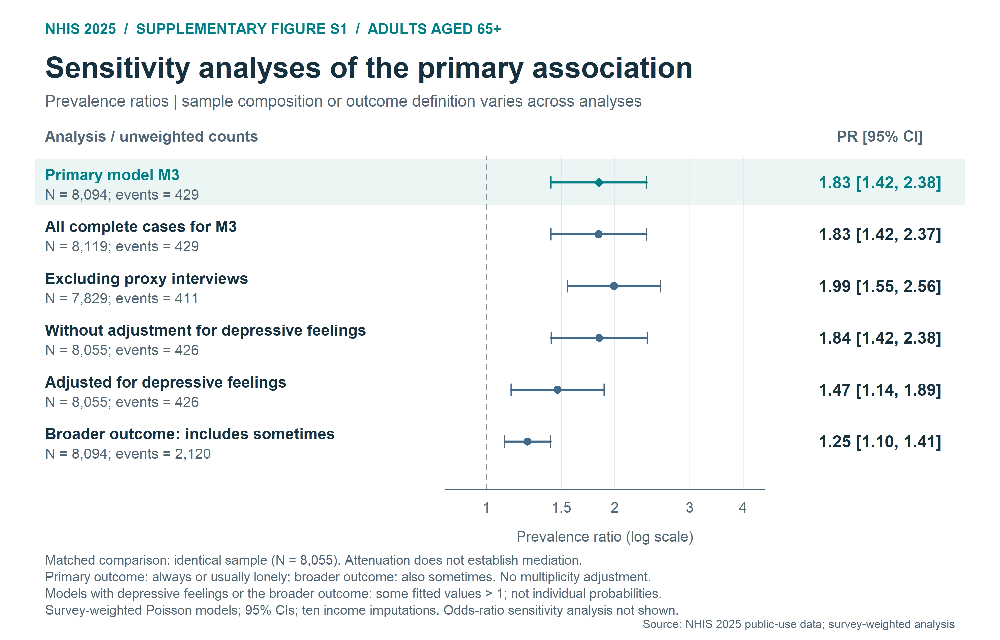
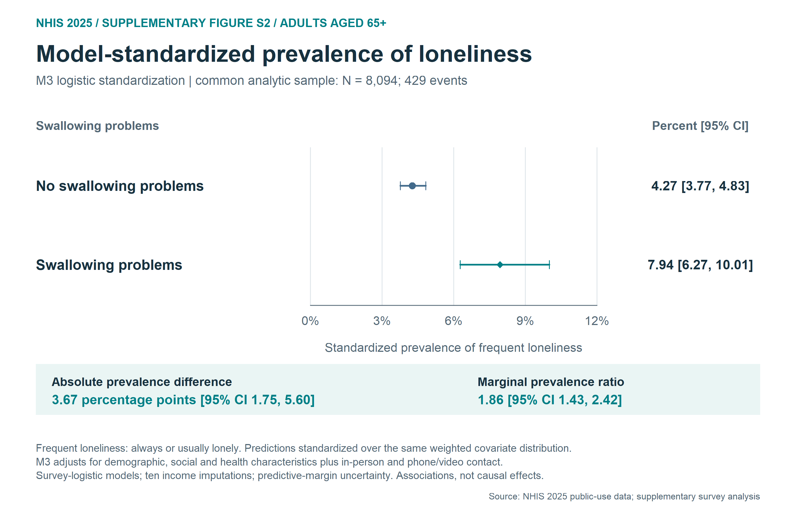
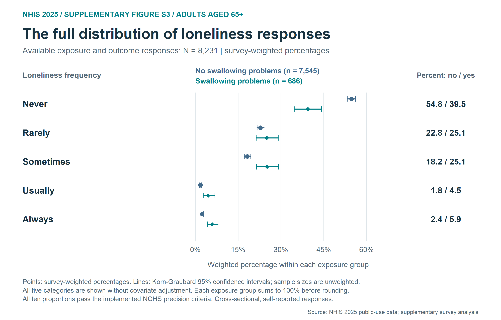

# Self reported swallowing problems and frequent loneliness in older US adults

Reproducible secondary analysis of public-use National Health Interview Survey
(NHIS) 2025 data among adults aged 65 years or older. The primary question is
whether self-reported swallowing problems are associated with frequent loneliness
after adjustment for measured social contact frequency.

The study is cross-sectional. Swallowing problems are self-reported and are not
clinically confirmed dysphagia. Estimates describe associations, not causal effects.

## Latest manuscript package: Dysphagia

The latest journal-formatted version is in [`outputs/dysphagia/`](outputs/dysphagia/).
The statistical results are unchanged. Use the authoring master for continued
editing and the anonymous copy for preparation of reviewer-facing material.

| File | Purpose |
|---|---|
| [Dysphagia authoring master](outputs/dysphagia/NHIS2025_Dysphagia_Master.docx) | Editable manuscript with real Zotero citation fields and the Dysphagia citation style |
| [Anonymous manuscript](outputs/dysphagia/NHIS2025_Dysphagia_Anonymous.docx) | Separate reviewer version with citations converted to text and identifying author information removed |
| [Author information and declarations](outputs/dysphagia/NHIS2025_Dysphagia_Author_Information.docx) | Author details and declarations for the submission system; keep separate from reviewer files |
| [Online Resource 1: supplementary figures](outputs/dysphagia/ESM1.pdf) | Three supplementary figures with captions |
| [Online Resource 2: supplementary tables](outputs/dysphagia/ESM2.xlsx) | All 17 extended TSV tables, two analysis records and five additional original tables; 25 worksheets including the index |
| [Journal figure files](outputs/dysphagia/figures/) | Figures 1–3 and three supplementary figures in EPS, PDF, PNG and 600-dpi TIFF formats |
| [Submission notes](outputs/dysphagia/Submission_notes.txt) | Official-source formatting check, submission-system caveats and outstanding author information |

Anel Karisik's competing-interest declaration, the study-specific author
contributions, and the applicable local ethics determination remain to be
supplied or confirmed. No absence of conflicts, institutional exemption or
author contribution has been inferred. No manuscript has been submitted or
accepted. Consult `VALIDATION_STATUS.txt` in the complete archive for the Word,
Zotero and layout checks recorded for each manuscript version.

The journal-formatted files complement the earlier general English manuscript
and figure gallery below. This private repository contains the complete research
archive; use the separate anonymous files when preparing
a double-anonymous submission.

### Journal figures

**Fig. 1. Weighted prevalence**



[EPS](outputs/dysphagia/figures/Fig1.eps) | [PDF](outputs/dysphagia/figures/Fig1.pdf) | [600-dpi TIFF](outputs/dysphagia/figures/Fig1.tiff)

**Fig. 2. Sequential adjustment models**



[EPS](outputs/dysphagia/figures/Fig2.eps) | [PDF](outputs/dysphagia/figures/Fig2.pdf) | [600-dpi TIFF](outputs/dysphagia/figures/Fig2.tiff)

**Fig. 3. Swallowing difficulty severity**



[EPS](outputs/dysphagia/figures/Fig3.eps) | [PDF](outputs/dysphagia/figures/Fig3.pdf) | [600-dpi TIFF](outputs/dysphagia/figures/Fig3.tiff)

[Full journal captions](outputs/dysphagia/figures/Figure_captions.txt)

## Original English figure gallery

All six English figures are displayed below and are available directly in
[`outputs/figures_en/`](outputs/figures_en/) as individual PNG and SVG files.
No archive download is needed to view them. The three main figures and three
supplementary figures describe cross-sectional associations in NHIS 2025 adults
aged 65 years or older; full captions give the methods and limitations.

### Main figures

**Figure 1. Weighted prevalence**



Survey-weighted prevalence of frequent loneliness by self-reported swallowing problems, with 95% confidence intervals; unadjusted descriptive analysis (N = 8,231).

[Full-resolution PNG](outputs/figures_en/Figure1_Weighted_Prevalence.png) | [Vector SVG](outputs/figures_en/Figure1_Weighted_Prevalence.svg)

**Figure 2. Sequential adjustment models**



Prevalence ratios across sequential adjustment models in the same complete-case sample (N = 8,094). M3 is the primary model; changes across models do not measure causal mediation.

[Full-resolution PNG](outputs/figures_en/Figure2_Sequential_Models.png) | [Vector SVG](outputs/figures_en/Figure2_Sequential_Models.svg)

**Figure 3. Swallowing difficulty severity**



M3-adjusted prevalence ratios by reported swallowing difficulty severity (N = 8,093). The questionnaire categories are not a clinically validated dysphagia severity scale.

[Full-resolution PNG](outputs/figures_en/Figure3_Severity.png) | [Vector SVG](outputs/figures_en/Figure3_Severity.svg)

### Supplementary figures

**Figure S1. Sensitivity analyses**



Prevalence ratios under alternative samples, adjustment sets and loneliness definitions. Sample composition and outcome definitions differ across rows.

[Full-resolution PNG](outputs/figures_en/FigureS1_Sensitivity.png) | [Vector SVG](outputs/figures_en/FigureS1_Sensitivity.svg)

**Figure S2. Standardized prevalence**



Model-standardized prevalence from survey-weighted logistic models with M3 covariates (N = 8,094), pooled over ten income imputations. These standardized associations are not causal effects.

[Full-resolution PNG](outputs/figures_en/FigureS2_Standardized_Prevalence.png) | [Vector SVG](outputs/figures_en/FigureS2_Standardized_Prevalence.svg)

**Figure S3. Loneliness response distribution**



Survey-weighted percentages for all five loneliness response categories by swallowing problems, with 95% confidence intervals (N = 8,231); no covariate adjustment.

[Full-resolution PNG](outputs/figures_en/FigureS3_Loneliness_Distribution.png) | [Vector SVG](outputs/figures_en/FigureS3_Loneliness_Distribution.svg)

### Complete captions and PDF downloads

- [Figures 1-3 and Figure S1: vector PDF](outputs/figures_en/NHIS2025_Figures_EN.pdf)
- [Figures S2-S3: vector PDF](outputs/figures_en/NHIS2025_Extended_Figures_EN.pdf)
- [Full captions and methods notes: Figures 1-3 and S1](outputs/figures_en/Captions_and_Notes.txt)
- [Full captions and methods notes: Figures S2-S3](outputs/figures_en/Captions_Extended_Figures_EN.txt)

## Start with the complete archive

Download `NHIS2025_Complete_Project.zip` and extract it before running the project.
The archive contains the complete folder tree, original data, analysis code,
results, literature records, reviewed Word and HTML manuscripts, actual Zotero citation data and figure files. The
expanded files in the GitHub repository include the directly viewable figure
gallery and a selection of project files. To reproduce the analysis, extract the
archive, which contains the complete folder tree.

Start with the Dysphagia-specific files listed above for journal preparation.
The earlier `outputs/NHIS2025_Manuscript_EN.docx` remains available as the
general English manuscript. Its citation fields link to real items in the Zotero project library.
The reviewed `outputs/NHIS2025_Manuscript_EN.html` provides a browser-readable
version with Zotero-rendered references. Read `VALIDATION_STATUS.txt` inside the
archive for the recorded Word-layout and application-level Zotero-refresh checks.

## Project contents

- `outputs/01_Analyseplan.txt`: the original analysis plan, saved before the original cross-tabulations and regression models.
- `outputs/02_Analyse.R`: original preparation, feasibility checks and survey-weighted main/sensitivity analyses.
- `outputs/09_Analyseplan_Nachtrag.txt`: dated plan for supplementary analyses, after the original results were known.
- `outputs/10_Extended_Analysis.R`: additional analyses, including predictive margins, missing-data sensitivity and descriptive precision checks.
- `outputs/tables/` and `outputs/extended_tables/`: machine-readable results.
- `outputs/figures_en/`: English PNG, SVG and PDF figures, captions and source inputs.
- `outputs/dysphagia/`: latest journal-formatted authoring master, anonymous manuscript, author/declaration sheet, Online Resources 1–2 and journal figure files.
- `outputs/08_Figures_EN.R`: reproducible English figure generator.
- `outputs/12_Extended_Figures_EN.R`: supplementary English figure generator.
- `outputs/literature/`: verified reference metadata and search documentation.
- `outputs/source_data/`: canonical, unchanged downloaded public-use CSV files and CDC ZIP archives.
- `outputs/NHIS2025_Manuscript_EN.docx`: reviewed, editable English manuscript with citation fields linked to real Zotero library items.
- `outputs/NHIS2025_Manuscript_EN.html`: reviewed English manuscript for browser reading, with references rendered by Zotero.
- `outputs/manuscript_sources/`: manuscript content, builder and Zotero project script.
- `outputs/literature/zotero_citations_dysphagia.json`: citations and bibliography exported from the real Zotero library using the genuine Dysphagia CSL style and its Springer Vancouver parent.
- `work/raw/`: created by `RunAll.ps1` from the canonical source files when needed; omitted from the archive to avoid duplicated data.
- `work/docs/`: official CDC codebook and methodological documents.
- `FILE_MANIFEST.tsv`: SHA-256 checksums for every archived file other than the manifest itself.

The original German report covers the first analysis stage. Consult
`outputs/11_Extended_Results.txt` and `outputs/extended_tables/` for the subsequent
analyses. Some original plans and audit material remain in German to preserve
the analysis record. No draft has been submitted or peer reviewed.

## Data provenance

Official landing page:
<https://www.cdc.gov/nchs/nhis/documentation/2025-nhis.html>

Original files:

| File | Contents |
|---|---|
| `adult25csv.zip` / `adult25.csv` | Sample Adult 2025 public-use data: 24,215 rows and 577 columns |
| `adultinc25csv.zip` / `adultinc25.csv` | Ten official family-income imputations for each Sample Adult |
| `adult-codebook.pdf` | Adult variable definitions, universes, missing codes and reference frequencies |
| `srvydesc-508.pdf` | Survey design and analytic guidance |
| `income-techdoc.pdf` | Official income-imputation methods |

Raw files are unchanged and stored once in `outputs/source_data/`. `RunAll.ps1`
copies missing raw files into `work/raw/`, preserving the paths expected by the
original reproduction scripts. The original download script then checks
archive/document hashes and stops if CDC replaces a file with another version.

## Reproduce on Windows

Requirements: R, internet access for any missing packages/files, and PowerShell.
The recorded original environment used R 4.6.0, survey 4.5 and mitools 2.7. Exact
session records are provided with the results. The package installation is not
version-locked; preserve the recorded environment for strict long-term replication.

From the repository root:

```powershell
./RunAll.ps1 -Rscript 'C:/Program Files/R/R-4.6.0/bin/Rscript.exe'
```

This first copies any missing original data from `outputs/source_data/` to
`work/raw/`. It verifies/downloads official files, installs required R packages
locally under `work/R-library/`, runs the original analysis and report, then the
supplementary analysis and both English figure generators (`08_Figures_EN.R` and
`12_Extended_Figures_EN.R`). It recreates `work/prepared.rds` before the
supplementary script reads it. Run from the extracted project root, since the
original scripts intentionally use relative `outputs/` and `work/` paths.

For another operating system, provide the same source files under `work/raw/`
and `work/docs/`, install `survey`, `mitools` and `pdftools`, and execute:

```sh
Rscript outputs/02_Analyse.R
Rscript outputs/10_Extended_Analysis.R
Rscript -e "source('outputs/05_Bericht.R', encoding='UTF-8')"
Rscript -e "source('outputs/08_Figures_EN.R', encoding='UTF-8')"
Rscript outputs/12_Extended_Figures_EN.R
```

Figure scripts read saved results; they do not refit models. The figure captions
explain their denominators and distinguish prevalence ratios from odds ratios.
Local package caches, application credentials, temporary renderings and binary
intermediate analysis objects are not tracked.

To build a local editable Word manuscript from the included Zotero export, install `python-docx`
and run `python outputs/manuscript_sources/build_manuscript.py` from the extracted
project root. The builder checks real item keys/URIs and citation sequence. It
does not perform Word/Zotero Refresh or visual pagination review. Any newly
generated Word file still requires those checks before delivery. See
`outputs/literature/Zotero_README.txt` for citation provenance and
`outputs/Manuscript_submission_notes.txt` for author-supplied submission details.
The Zotero developer script contains the original local project path; update
that path for another installation before running it inside Zotero. It is not
needed to use the included citation export and rebuild the manuscript.

For the Dysphagia version, the corresponding builder is
`outputs/manuscript_sources/build_dysphagia.py`; it uses
`outputs/literature/zotero_citations_dysphagia.json` and the supplied journal
figures and author information. Regeneration does not perform native Word/Zotero
Refresh or page review. Keep the field-enabled master and field-free reviewer
copy separate. `build_esm2.mjs` and `finalize_esm2.py` reproduce and verify the
supplementary workbook using the documented bundled Artifact Tool environment.

## Statistical principles

- Define the full Sample Adult survey design before creating analysis domains.
- Use the final annual adult weight, public-use strata and primary sampling units.
- Handle numeric nonresponse codes and structural skips according to the codebook.
- Fit the income-adjusted models separately in all ten official imputations and pool uncertainty.
- Keep the original primary analysis distinct from supplementary analyses planned after its results were known.
- Report sample sizes, uncertainty, missingness and model limitations without claiming causation or publication novelty.

See the analysis plans, full report and supplementary results for the exact
definitions and limitations. A complete-case analysis does not by itself resolve
item nonresponse bias; additional weighting/model checks also depend on assumptions.

## Rights and attribution

Data and CDC documentation are provided by CDC/NCHS, with their original source
and attribution retained. This repository does not assert ownership of CDC/NCHS
materials or apply a new license to those materials. No project-wide open-source
license has yet been assigned to the original code or manuscript. See `RIGHTS.md`.

Repository: <https://github.com/benlabeit/nhis2025-swallowing-loneliness>
