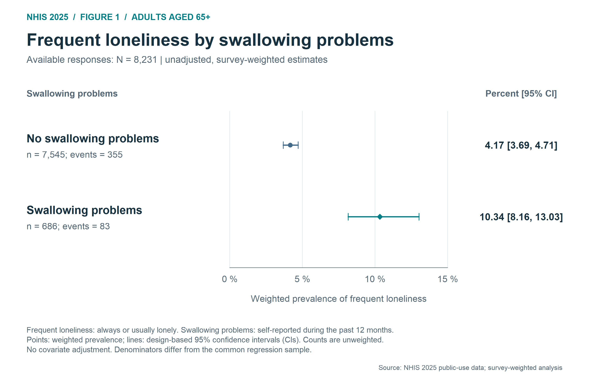
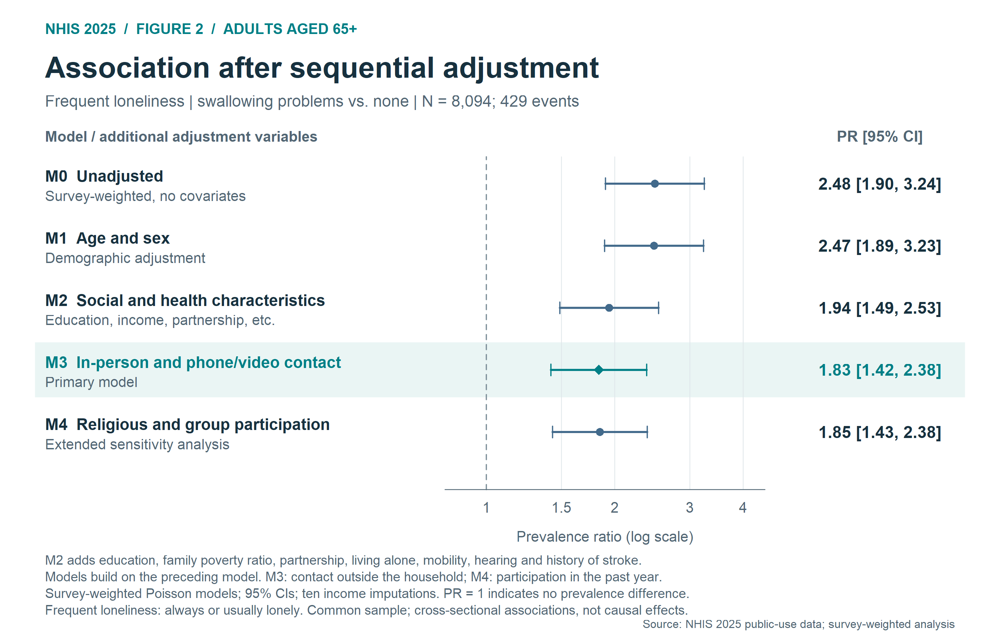
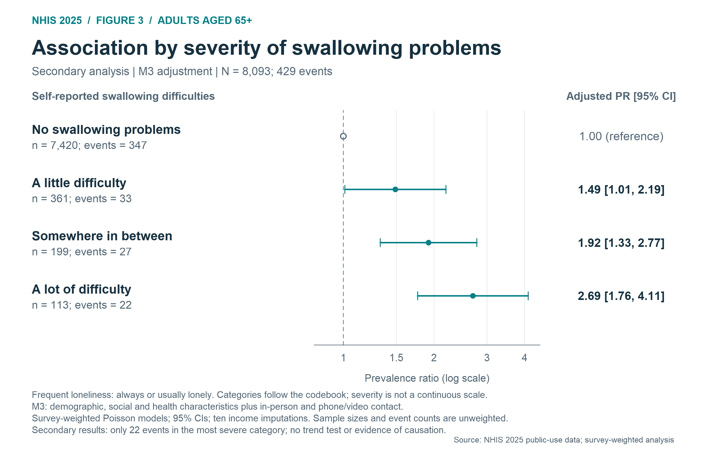
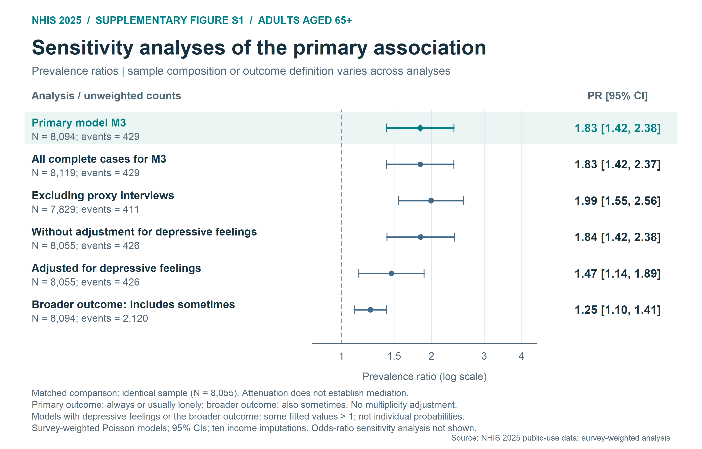
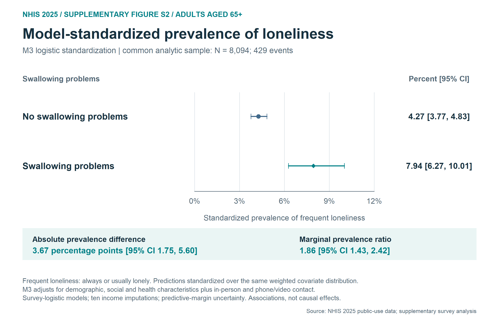
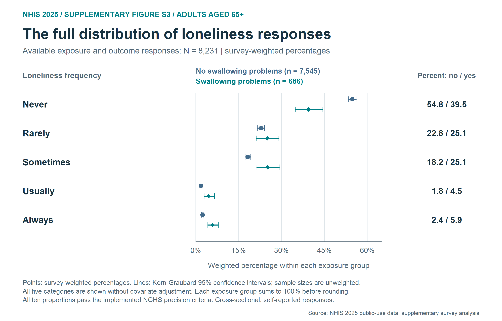

# English figures: swallowing problems and loneliness, NHIS 2025

Three main figures and three supplementary figures are available directly in
this folder. Click a PNG link for the full-resolution image or download the
SVG/PDF for vector output. All labels and captions are in English.

The figures describe cross-sectional self-reported associations among adults
aged 65 years or older. They do not establish causation or clinically confirmed
dysphagia. Full captions specify denominators, adjustment, uncertainty and
limitations.

## Main figures

**Figure 1. Weighted prevalence**

Survey-weighted prevalence of frequent loneliness by self-reported swallowing problems, with 95% confidence intervals; unadjusted descriptive analysis (N = 8,231).

[Full-resolution PNG](Figure1_Weighted_Prevalence.png) | [Vector SVG](Figure1_Weighted_Prevalence.svg)

**Figure 2. Sequential adjustment models**

Prevalence ratios across sequential adjustment models in the same complete-case sample (N = 8,094). M3 is the primary model; changes across models do not measure causal mediation.

[Full-resolution PNG](Figure2_Sequential_Models.png) | [Vector SVG](Figure2_Sequential_Models.svg)

**Figure 3. Swallowing difficulty severity**

M3-adjusted prevalence ratios by reported swallowing difficulty severity (N = 8,093). The questionnaire categories are not a clinically validated dysphagia severity scale.

[Full-resolution PNG](Figure3_Severity.png) | [Vector SVG](Figure3_Severity.svg)

## Supplementary figures

**Figure S1. Sensitivity analyses**

Prevalence ratios under alternative samples, adjustment sets and loneliness definitions. Sample composition and outcome definitions differ across rows.

[Full-resolution PNG](FigureS1_Sensitivity.png) | [Vector SVG](FigureS1_Sensitivity.svg)

**Figure S2. Standardized prevalence**

Model-standardized prevalence from survey-weighted logistic models with M3 covariates (N = 8,094), pooled over ten income imputations. These standardized associations are not causal effects.

[Full-resolution PNG](FigureS2_Standardized_Prevalence.png) | [Vector SVG](FigureS2_Standardized_Prevalence.svg)

**Figure S3. Loneliness response distribution**

Survey-weighted percentages for all five loneliness response categories by swallowing problems, with 95% confidence intervals (N = 8,231); no covariate adjustment.

[Full-resolution PNG](FigureS3_Loneliness_Distribution.png) | [Vector SVG](FigureS3_Loneliness_Distribution.svg)

## Complete captions and PDF downloads

- [Figures 1-3 and Figure S1: vector PDF](NHIS2025_Figures_EN.pdf)
- [Figures S2-S3: vector PDF](NHIS2025_Extended_Figures_EN.pdf)
- [Full captions and methods notes: Figures 1-3 and S1](Captions_and_Notes.txt)
- [Full captions and methods notes: Figures S2-S3](Captions_Extended_Figures_EN.txt)

## Source files and reproduction

`Data_*.tsv` and `inputs/tables/` retain the original plotted inputs. The project
scripts `outputs/08_Figures_EN.R` and `outputs/12_Extended_Figures_EN.R` reproduce
the six figures from saved results; they do not refit the models. The complete
archive contains the analysis code, all result tables and original data. See the
[project README](../../README.md) for the full reproduction workflow.
